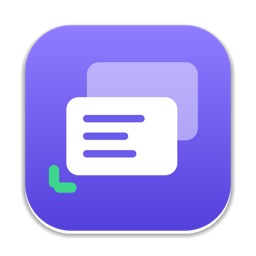
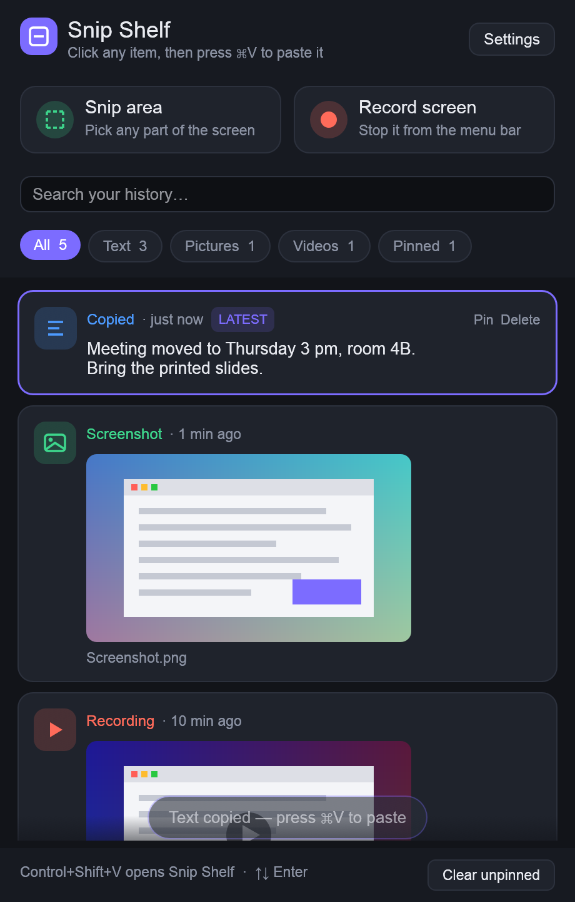

<p align="center">
  
</p>

<h1 align="center">Snip Shelf</h1>

<p align="center">
  A clipboard history for your Mac that also keeps your <b>screenshots</b> and <b>screen recordings</b>.<br>
  Click anything you copied, snipped or recorded, then press <b>⌘V</b> to paste it again.
</p>

<p align="center">
  <a href="../../releases/latest"><b>⬇ Download the latest .dmg</b></a>
</p>

<p align="center">
  
</p>

## What it does

- **Remembers what you copy.** Text, pictures and files you copy with ⌘C show up as cards.
- **Catches screenshots and recordings.** Anything you take with ⌘⇧3, ⌘⇧4 or ⌘⇧5 is added automatically.
- **Snip and Record buttons.** Capture part of the screen or record a video right from the app; the result is copied straight away.
- **Click, then ⌘V.** Clicking a card puts it back on the clipboard and hides the window, so you can paste right where you were. Text pastes as text, pictures as pictures, and videos as the video file.
- **Pin your favourites.** Pinned items are never cleared, even after you quit or restart.
- **Search and filters.** Show all items, or only Text, Pictures, Videos or Pinned.
- **Always at hand.** Press **Control+Shift+V** anywhere, or use the icon in the menu bar.
- **Private.** Everything stays on your Mac. Nothing is uploaded, and passwords copied from password managers are skipped.

## Install

1. Download `SnipShelf-x.y.z.dmg` from the [Releases](../../releases/latest) page.
2. Open it and drag **Snip Shelf** onto **Applications**.
3. The first time you open it, macOS may say it "can't check the app for malicious software" because the app isn't from the App Store.
   Go to **System Settings → Privacy & Security**, scroll down and click **Open Anyway**. (Or right-click the app, choose **Open**, then **Open**.)
4. Snip Shelf can now be found with **⌘Space** → "Snip Shelf".

When you first use **Snip** or **Record**, macOS asks for permission to record the screen. Allow it in **System Settings → Privacy & Security → Screen & System Audio Recording**.

Works on macOS 11 Big Sur or newer, on both Apple-chip (M1/M2/M3/M4…) and Intel Macs.

## Where things are saved

Your history, snips, recordings and copied pictures are saved in
`~/Library/Application Support/Snip Shelf/`. Screenshots that macOS saves on your Desktop are also copied there.
Use **Settings → Show saved pictures & videos** in the app to open that folder.

## Build it yourself

You need [Rust](https://rustup.rs) and the Xcode Command Line Tools.

```sh
cargo run --release          # run it
./make-app.sh                # build "Snip Shelf.app" and dist/SnipShelf-x.y.z.dmg
```

To build the universal app you also need the Intel target: `rustup target add x86_64-apple-darwin`.

Made with Rust and [egui](https://github.com/emilk/egui).

## License

MIT. See [LICENSE](LICENSE).
